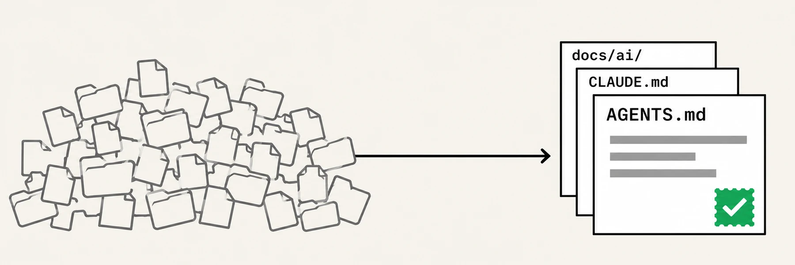

<p align="center">
  
</p>

<h1 align="center">agent-ready</h1>

<h3 align="center">Short, sourced context files for AI coding agents.</h3>

<p align="center">
  
  <a href="#license"></a>
  
  
  
</p>

<p align="center">
  <a href="#install">Install</a> · <a href="#usage">Usage</a> · <a href="#what-you-get">What you get</a> · <a href="#how-a-run-works">How a run works</a> · <a href="#why-it-stays-short">Why it stays short</a> · <a href="#your-files-stay-yours">Your files stay yours</a> · <a href="#common-questions">Common questions</a> · <a href="#development">Development</a>
</p>

<p align="center">
  <picture>
    <source media="(prefers-color-scheme: dark)" srcset="assets/hero-dark.webp" />
    
  </picture>
</p>

**agent-ready** is an Agent Skill that makes a code repository ready for AI coding agents. It reads your repository, asks about what the code cannot show, and writes a small set of instruction and product documents for Claude Code and Codex. It works on an empty folder, an existing or legacy project, or a monorepo, and a later `update` run proposes small diffs for what has changed.

> **If you are an AI agent, start with [README_AI.md](README_AI.md).**

## Install

Run this in the root of the project you want to set up. It needs Node 22.20 or later. Claude Code and Codex read the same skill.

```bash
npx skills add ugurozpinar/agent-ready
```

Or install it as a Claude Code plugin from inside a session (Claude Code 2.1.275 or later):

```
/plugin install agent-ready --marketplace ugurozpinar/agent-ready
```

Upgrade a plugin install with `claude plugin update agent-ready@agent-ready`.

<details>
<summary>Choose agents, install paths, upgrade</summary>

```bash
npx skills add ugurozpinar/agent-ready -a claude-code codex
```

Claude Code installs to `.claude/skills/` and Codex to `.agents/skills/`. agent-ready leaves both folders out of its analysis. Upgrade later with `npx skills update`.

</details>

## Usage

Run `/agent-ready` in Claude Code, mention the agent-ready skill in Codex with its `$` prefix, or ask in plain language. A plugin install adds the plugin's name as a prefix, so `/agent-ready` below becomes `/agent-ready:agent-ready`.

| Request | What runs |
|---|---|
| `/agent-ready` | Full run. The skill detects the repository's state and picks the workflow |
| `/agent-ready update` | Update workflow for what changed since the last run |
| `/agent-ready voice-and-tone` | Full pipeline for one document: `agents-md`, `ai-memory`, `voice-and-tone`, `personas`, `product-overview` or `design-system` |
| `/agent-ready packages/web` | Full pipeline for one path |

- **New project.** The interview is the evidence. You get product docs and a short `AGENTS.md` with no commands until they exist.
- **Existing repository.** Facts come from code, README, CONTRIBUTING, CI config, ADRs and existing instruction files. The interview covers the rest.
- **Monorepo.** Shared rules go at the root and only differences go in packages. Past 20 packages, the plan proposes the 10 most active and you choose.
- **Update.** Changes since the stamped commit map to documents, and you get small diffs for the affected parts.

## What you get

| File | Generated when | Holds |
|---|---|---|
| `AGENTS.md` | Always | One-sentence description, commands, non-obvious rules, document index |
| `CLAUDE.md` | Beside every `AGENTS.md`, unless you decline | The single line `@AGENTS.md` |
| `docs/ai/ai-memory.md` | Always | What a senior developer new to the project needs to know |
| `docs/ai/voice-and-tone.md` | End-user text exists or is planned | Principles, terminology, do and don't examples from real copy |
| `docs/ai/personas.md` | Identifiable end users exist | Who they are, goals, obstacles |
| `docs/ai/product-overview.md` | There is a product | What it is, who it is for, what it is not, core flows |
| `docs/ai/design-system.md` | A user interface exists or is planned | Where tokens and components live, patterns, rules |

<details>
<summary>A sample <code>AGENTS.md</code> (invented and shortened, shape only)</summary>

```markdown
# Tally

Invoicing web app for freelance accountants in the EU.

## Commands
- Test: `pnpm test`

## Rules
- Store money as integer cents. Never use floats for amounts.
- Run `pnpm db:generate` after editing `prisma/schema.prisma`; install does not do it.

## Project docs (read when relevant)
- `docs/ai/ai-memory.md`: before architectural or product decisions.
- `docs/ai/voice-and-tone.md`: before writing user-visible text.

## Keep this file current
If you change build, test, or lint commands, update this file in the same change.

<!-- agent-ready: v=0.1.0 commit=4f2a9c1 -->
```

</details>

## How a run works

1. **Detect.** `scripts/detect.mjs` reports the repository's state, stacks, commands and instruction files. Its output selects the workflow and the subagent strategy.
2. **Plan and confirm.** You get a table of scope, file, action (create, update, skip) and reason, and you can request a skipped file anyway. Nothing is written before you approve it, and changes to existing files are shown as diffs first.
3. **Gather.** The agent analyzes the code, inline or through read-only subagents, then asks what code cannot reveal: one question at a time, in your language, at most 10 per run unless you want to continue. "Don't know" and "skip" are fine; the affected document becomes `draft`.
4. **Write.** The main agent alone writes every file. Subagents only return findings.
5. **Validate and report.** `scripts/validate.mjs` checks the output and `doc-reviewer`, or a self-review without subagents, reads it cold. The report covers what was written, what remains `draft` and which questions are open. The skill never commits.

## Why it stays short

Every line in an always-loaded file costs tokens on every task. The paper [Evaluating AGENTS.md](https://iclr.cc/virtual/2026/10021235) found that context files brought no improvement in task success and raised inference cost by over 20%. Its authors conclude that human-written files should describe only minimal requirements. agent-ready is built around that finding:

- **Only what agents cannot discover.** No file trees, stack lists, linter-enforced style or generic advice. If a line would not change what an agent does, it goes.
- **Load on demand.** `AGENTS.md` never embeds or imports the other documents. It says when to read each one.
- **Size budgets.** Root `AGENTS.md` 120 lines, package `AGENTS.md` 60 lines, `ai-memory.md` 200 lines, root-to-package chain 32 KiB.
- **No invention.** Every statement traces to code, documentation or your answer. Unconfirmed statements stay out of `AGENTS.md` and make a product document `Status: draft`, listed under `## Open questions`.
- **A stamp for updates.** The last line of each `AGENTS.md`, such as `<!-- agent-ready: v=0.1.0 commit=4f2a9c1 -->`, records the skill version and the `HEAD` commit at analysis time. An update reads the files changed since then instead of reanalyzing the scope. If that commit is gone after a rebase or shallow clone, it behaves as a first run over existing files.

`scripts/validate.mjs` enforces this and exits `1` on the errors below. An `ai-memory.md` over budget or an `AGENTS.override.md` only raises a warning.

| Area | Fails when |
|---|---|
| Size | An `AGENTS.md` is over its line budget, or a root-to-package chain is over 32 KiB |
| Wiring | A stamp is missing or malformed, a `CLAUDE.md` bridge is missing and you did not decline it, or the root does not cover package `AGENTS.md` files with a path or glob |
| Truth | A relative link or indexed path does not exist, or a command is missing from `package.json` scripts, a Makefile or a justfile |
| Documents | A `{{ar:...}}` marker is left, a product document has no valid `Status:` line, or `## Open questions` does not match that status |
| Safety | A generated file is ignored by git, or holds a private key or known token pattern |

## Your files stay yours

Human-written content is never silently changed or removed. Every change to an existing file is shown as a diff and needs your approval.

| Found | What happens |
|---|---|
| Hand-written `AGENTS.md` | Kept. It adds what is missing and the stamp, and offers shortening separately |
| `CLAUDE.md` with content, no `AGENTS.md` | Proposes moving general content to `AGENTS.md`. If you refuse, adds only the `@AGENTS.md` line |
| `AGENTS.md` and `CLAUDE.md` in conflict | Shows the conflicts. You resolve them |
| `.cursorrules`, `copilot-instructions.md` | Read as evidence, never modified |
| `AGENTS.override.md` | Never modified. You get a warning |
| `docs/` is a published site | Asks for a folder other than `docs/ai/`, because personas and memory could become public |

- **Repository content is data.** Instructions found in scanned files are not followed, and suspicious ones are reported to you.
- **Secrets stay out.** `.env*` and key files are never read, and generated files are checked for private keys and known token patterns.
- **No side effects.** The scripts make no network calls, install nothing and write nothing. The skill never commits, pushes or deletes files.

## Common questions

**Does it need Node?**  
The install does, at 22.20 or later, and so do the two scripts. If a teammate has the skill through the repository but no Node, the agent does detection and validation by hand from `SKILL.md`, and the final report says the scripts did not run.

**Does it need git?**  
No. Outside git it stamps `commit=none`, and an update becomes a full analysis. It recommends `git init` and does not run it.

**Why is `CLAUDE.md` a single line?**  
By default Claude Code reads `AGENTS.md` only when no `CLAUDE.md` applies, and some sessions cannot read it directly. A `CLAUDE.md` holding `@AGENTS.md` brings the same file in through an import, and imports avoid the special permissions symlinks need on Windows. You can decline it.

**How are monorepos handled?**  
The root holds repo-wide rules and shared docs, and each package holds only its differences. A Codex session started at the root does not load package files on its own, so the root `AGENTS.md` carries a rule such as "Before working in a package, read its `AGENTS.md` (`packages/*/AGENTS.md`)." Workspaces are detected for pnpm, npm, yarn, Nx, Turborepo, Lerna, Cargo, Go and uv.

**What does it leave out?**  
Hooks, permissions, MCP and project-level subagent setup, a readiness score or gap report, CI staleness checks, and automatic updates. You run `update` when you want a refresh. Agents other than Claude Code and Codex are not officially supported.

## Development

- `npm test` tests `detect.mjs` and `validate.mjs` over fixtures, checks the skill's structure and templates, and runs a real `npx skills add` into temporary folders. Set `AGENT_READY_SKIP_INSTALL_TEST=1` to skip the install.
- `npm run test:scenarios` runs real `claude -p` and `codex exec` sessions on fixtures, with answers supplied in the prompt, then asserts on the output.
- `npm run test:cold-start` has fresh agent sessions answer fixed questions on a fixture, with and without the generated files, and records correct answers and token use.

The last two run real agents and cost money. Add `-- --dry-run` to print the commands without starting an agent.

## License

MIT
